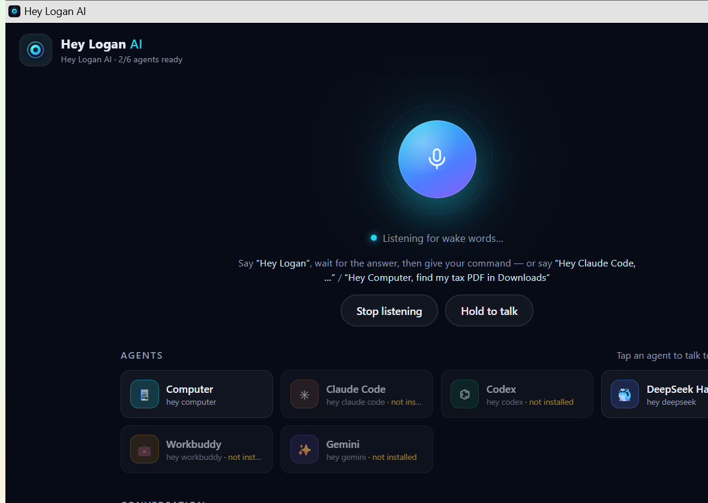

# Hey Logan AI — Windows installer + Android app

Built from **[wolverinenhm/Hey-Logan-AI](https://github.com/wolverinenhm/Hey-Logan-AI)**.

Hey Logan AI turns your PC into a private voice command center. It runs a small
server on your computer and gives you a voice assistant that can search your
files, open folders and apps, control the PC, and hand longer tasks to AI
command-line agents (Claude Code, Codex, DeepSeek, Gemini, Workbuddy) if you
have them installed. You can talk to it on the PC or from your Android phone.

**New in 1.1.0 — hands-free:**
- **No “Start listening” button.** The app starts listening when it opens: call
  **“Hey Logan”**, hear *“Logan here.”*, then say what you want.
- **Starts with Windows** (on by default) and is already listening when you log
  in — toggle later with the **Start at Login On/Off** shortcuts.

| What | File | Who it is for |
|---|---|---|
| **Windows installer** | `dist\HeyLoganAI-Setup-1.1.0-win-x64.exe` | Any 64-bit Windows 10/11 PC |
| Windows portable | `dist\HeyLoganAI-Portable-1.1.0-win-x64.zip` | Run without installing |
| **Android app (APK)** | `dist\HeyLoganAI-android-1.1.0.apk` | Android 8.0+ phone or tablet |
| Android project source | `dist\HeyLoganAI-Android-Project-1.1.0.zip` | Rebuild/customise the app |

Nothing to install first: the Windows build carries its own private Node.js
runtime, and the APK is signed and ready to sideload.

> **Where to download:** the four prebuilt files are attached to the
> **[Releases page](../../releases)** of the public repository (the binaries are
> not stored in git). In this archive they are in `dist\`.

### Checksums (SHA-256)

| File | Size (bytes) | SHA-256 |
|---|---:|---|
| `HeyLoganAI-Setup-1.1.0-win-x64.exe` | 23,607,146 | `1A9131CB90DEA921772542A0DEE329855460C8079F789CAB05ACF904640EB586` |
| `HeyLoganAI-Portable-1.1.0-win-x64.zip` | 35,114,765 | `25CAA3921530039D5AAC1695FE7A6E01CC82DB49343F3A18F856CBB49ED9BB8B` |
| `HeyLoganAI-android-1.1.0.apk` | 226,868 | `CCB8FB6E2FF57D856621A0E1ACD41E90A1AF4323A364B19CBDFD31047DBE0173` |
| `HeyLoganAI-Android-Project-1.1.0.zip` | 236,017 | `D3B945956F6041F1D3920E6F30E7AF01FE937150508C3B7D3CF4CFD1EFCE9ED9` |

The same list is in `dist\SHA256SUMS.txt`. Verify on Windows with
`Get-FileHash .\HeyLoganAI-Setup-1.1.0-win-x64.exe -Algorithm SHA256`, on
Linux with `sha256sum -c SHA256SUMS.txt`, on macOS with
`shasum -a 256 -c SHA256SUMS.txt`.

---

## 1. Windows — install

1. Double-click **`HeyLoganAI-Setup-1.1.0-win-x64.exe`**.
2. Windows SmartScreen will warn because the installer is not code-signed
   (that needs a paid certificate): click **More info → Run anyway**.
3. The setup wizard installs Hey Logan AI **for the current user only** — no
   administrator rights. If an older version is installed, the wizard reuses
   **that same folder**, so an update replaces the existing copy and keeps your
   token, settings and phone pairing.
4. Finish the wizard (leave **Run Hey Logan AI** ticked).

The installer adds a Start Menu group **Hey Logan AI**, a Desktop shortcut, an
entry in **Settings → Apps**, and start-with-Windows (on by default).

### First run — just talk to it

Open the **Hey Logan AI** shortcut (or wait for your next login). The server
starts silently, the app opens, and it is already listening:

> Say **“Hey Logan.”** → it answers out loud **“Logan here.”** → then say
> **“Find my budget PDF in Downloads.”**



You can also say the wake word and command in one breath (*“Hey Logan, find my
budget PDF in Downloads”*), address an agent directly (*“Hey Computer, open
Downloads”*, *“Hey Claude Code, summarise the repo”*), or type in the bottom bar.
With **“Hey Logan”**, naming an agent inside the sentence routes the command
there — otherwise your default agent (Computer) handles it.

### Hands-free details

- The launcher gives the app window its **own private browser profile** with the
  microphone pre-authorised for the app address, and enables audio playback for
  that window — so there is no permission popup and no click, even right after
  you log in.
- **Turn it off/on:** gear icon → **Voice** → *Always listen for “Hey Logan”*.
  **Stop listening** pauses for the session; **Hold to talk** sends one command
  without the wake word.
- **Start with Windows:** *Settings → Apps* entry plus Start Menu →
  **Start at Login On/Off**.

## 2. Android — install

1. Copy **`HeyLoganAI-android-1.1.0.apk`** to the phone and tap it (allow
   *“Install unknown apps”* for the app you open it from), or
   `adb install -r HeyLoganAI-android-1.1.0.apk`. It updates over 1.0.0 and
   keeps the pairing.
2. On the PC: Start Menu → **Hey Logan AI → Pairing** — it shows the access
   token, the address and a QR code.
3. Open **Hey Logan AI** on the phone, allow the microphone once, then enter the
   address and token (or paste the pairing link) and tap **Connect**.
4. Accept the certificate explanation — it is generated by *your* PC.

After that the app starts listening when opened: say **“Hey Logan”**, hear
*“Logan here.”*, then give your command. Voice works inside the app because it
ships a native speech bridge (Android speech recognition + text-to-speech);
Android's WebView has no Web Speech API. A named agent inside the sentence
(“ask Claude Code to …”) still routes there.

> After updating the PC to 1.1.0, close and reopen the phone app once so its
> offline cache refreshes and picks up the new wake word.

Detailed guides: [docs/INSTALL-WINDOWS.md](docs/INSTALL-WINDOWS.md) · [docs/INSTALL-ANDROID.md](docs/INSTALL-ANDROID.md)

---

## What is in this folder

```
Hey-Logan-AI-Release\
  README.md                       this file
  dist\
    HeyLoganAI-Setup-1.1.0-win-x64.exe      Windows installer (per-user, no admin)
    HeyLoganAI-Portable-1.1.0-win-x64.zip   portable Windows build
    HeyLoganAI-android-1.1.0.apk            signed Android app
    HeyLoganAI-Android-Project-1.1.0.zip    Android Studio project + CI
    SHA256SUMS.txt                          checksums
  docs\
    INSTALL-WINDOWS.md            step-by-step + troubleshooting
    INSTALL-ANDROID.md            install, pairing, voice, troubleshooting
    VERIFICATION.md               independent QA report with evidence
  app\                            the application source used for every artifact
  windows\
    payload\HeyLoganAI\           the runnable tree the installer ships
    installer\                    NSIS script + build scripts
  android\                        Android Studio project
  assets\                         generated icons
  _test\                          build/test evidence (logs, screenshots, E2E results)
  _toolchain\                     the JDK 17 / Android SDK 35 / NSIS used to build the
                                  artifacts (only needed to rebuild; safe to delete)
```

Hashes, silent switches and evidence: `dist\SHA256SUMS.txt`,
`docs\VERIFICATION.md`, `_test\win-installer\TEST-RESULTS.md`.

## How it fits together

```
  Android app / PC app window                      Your PC
  +------------------------+    HTTPS + SSE      +------------------------------+
  |  Hey Logan AI UI       | ------------------> |  Hey Logan AI server         |
  |  wake words, STT, TTS  | <------------------ |  (bundled Node.js 22)        |
  |  sessions, pairing     |                     |  Computer agent + AI CLIs    |
  +------------------------+                     +------------------------------+
```

- `runtime\node.exe` is a private Node.js 22 runtime — the installer never needs
  Node.js on the machine and does not modify your system Node.
- `Launch.vbs` starts the server with **no console window**, waits for
  `/api/health`, reads the access token, ensures the app's private browser
  profile is pre-authorised for the microphone, and opens the UI in a chromeless
  Edge/Chrome app window with audio playback enabled (falls back to your default
  browser).
- The Android app is a native WebView shell around the same UI plus a speech
  bridge; it stores the pairing locally and only trusts your PC's certificate.

## Rebuilding

- **Windows:** run `powershell -File windows\installer\fetch-node.ps1` once
  (downloads the Node.js runtime into the payload — it is not stored in git),
  install [NSIS](https://nsis.sourceforge.io/), then run
  `powershell -File windows\installer\build-setup.ps1` (`-Makensis <path>` if
  needed; the release tree also ships one in `_toolchain\nsis`); the portable zip
  comes from `build-portable.ps1`.
- **Android:** install JDK 17 + Android SDK 35, then either open `android\` in
  Android Studio and *Build → Build APK(s)*, or run `gradle assembleRelease`. The
  release keystore and its password are in `android\release-keystore\` (do not
  share or lose it — it identifies your future updates).
  `android\tools\build-apk-manual.ps1` rebuilds and re-signs the APK with the raw
  SDK tools, which is how this release was built (Gradle could not run in this
  build environment).
- **App changes:** edit `app\`, run `node test\run.js` (87 tests), then rebuild.

## Known limitations

- The Windows installer is **not code-signed**, so SmartScreen warns once
  (“More info → Run anyway”). Removing that needs a paid signing certificate.
- The Windows installer does **not** modify Windows Firewall (that requires
  administrator rights). If your phone cannot connect, run **Allow through
  Firewall** from the Start Menu once and approve the prompt.
- The Android APK is sideloaded (not on Google Play); its runtime behaviour was
  verified by compilation, signatures and static analysis — no physical phone
  was available in the build environment.
- The microphone pre-authorisation uses the app's own private browser profile.
  If a browser ever ignores it, you get the normal “Allow microphone” popup
  **once**; hands-free works from then on.
- The phone works only while the PC app is running; both devices must be on the
  same network (or a Tailscale/tunnel address — see `app\README.md`).
- AI command-line agents are optional; the app tells you how to install any that
  are missing.

## License

The application is MIT licensed (see `app\LICENSE`). The bundled Node.js runtime
is distributed under its own licence.
