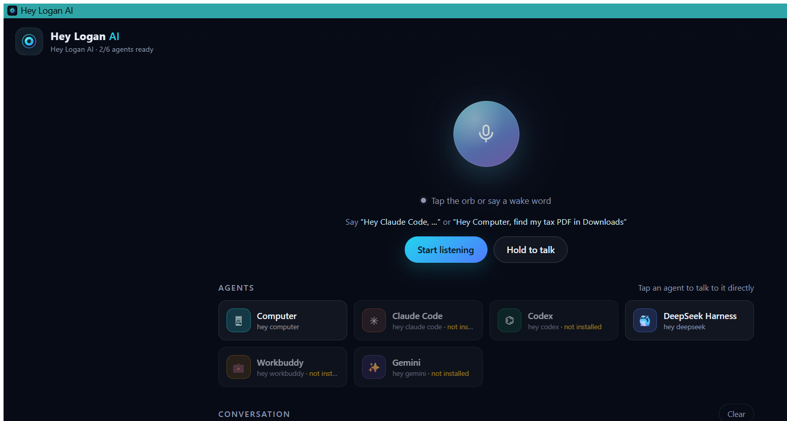

# Installing Hey Logan AI on Windows

Hey Logan AI runs a small server on your PC and opens the voice assistant in its
own window. No Node.js, Python or other runtime has to be installed — the
installer carries a private copy of Node.js 22.

## Requirements

- 64-bit Windows 10 or Windows 11 (x64).
- About 250 MB free disk space.
- No administrator rights needed (the installer is per-user).
- Microsoft Edge (preinstalled on Windows 10/11) or Google Chrome for the
  chromeless app window; without one the app opens in your default browser.

## 1. Run the installer

Run **`HeyLoganAI-Setup-1.0.0-win-x64.exe`**.

Windows SmartScreen may show *"Windows protected your PC"* because the installer
is not code-signed (a certificate costs money). Click **More info → Run anyway**.

The setup wizard then:

1. Asks where to install (default `%LOCALAPPDATA%\Programs\HeyLoganAI`).
2. Copies the app, the private Node.js runtime and the launcher scripts.
3. Creates a Start Menu group **Hey Logan AI** and a Desktop shortcut.
4. Registers **Hey Logan AI** in *Settings → Apps* so it can be uninstalled
   normally.
5. Offers **start at login** (on by default).
6. Does **not** touch Windows Firewall (that needs administrator rights). If your
   phone cannot reach the PC later, run the **Allow through Firewall** shortcut
   from the Start Menu and approve the prompt.
7. Offers to start Hey Logan AI when you finish.

### Silent / unattended

```
HeyLoganAI-Setup-1.0.0-win-x64.exe /S
```

In silent mode there is no wizard and no prompts, and the app is **not**
launched afterwards. Start-at-login is still enabled by default (as in the
wizard); add `/NOAUTOSTART` to skip it. To install elsewhere:

```
HeyLoganAI-Setup-1.0.0-win-x64.exe /S /NOAUTOSTART /D=C:\Apps\HeyLoganAI
```

(`/D=` must be the last parameter and unquoted, as usual for NSIS.)

Supported switches: `/S` (silent), `/NOAUTOSTART`, `/D=<dir>`.
Uninstaller: `/S` (silent, keeps `app\data`), `/PURGEDATA` (also delete
settings/token), `/KEEPDATA` (explicitly keep them).

## 2. First run

Open the **Hey Logan AI** shortcut. The server starts in the background with
**no console window** and the app opens in a chromeless window.

On first start it creates your settings, a private access token and a local
HTTPS certificate here:

```
%LOCALAPPDATA%\Programs\HeyLoganAI\app\data\config.json     settings + access token
%LOCALAPPDATA%\Programs\HeyLoganAI\app\data\certs\cert.pem  local HTTPS certificate
%LOCALAPPDATA%\Programs\HeyLoganAI\app\data\certs\key.pem   certificate key
```



Say (or type):

> "Hey Computer, find my budget PDF in Downloads."
> "Hey Computer, open Downloads."
> "Hey Computer, take a screenshot."

## 3. Pair your phone (firewall)

Start Menu → **Hey Logan AI → Pairing**. A console window shows your access
token, the phone URL, ready-to-open pairing links and a QR code.

If the phone cannot connect:

1. Make sure the PC and the phone are on the same Wi-Fi.
2. Start Menu → **Hey Logan AI → Allow through Firewall** (approve the Windows
   prompt), or add the rule manually for
   `%LOCALAPPDATA%\Programs\HeyLoganAI\runtime\node.exe` on **Private**
   networks.

The Windows network profile must be **Private** (Settings → Network → Wi-Fi →
Network profile).

## The Start Menu shortcuts

| Shortcut | What it does |
|---|---|
| **Hey Logan AI** | Starts the server (hidden) and opens the app window |
| **Start Console** | Starts the server with a visible console (log, URLs, errors) |
| **Pairing** | Shows the access token, phone URL, pairing links and QR code |
| **Stop Server** | Stops the background server |
| **Allow through Firewall** | Adds the Private-network firewall rule |
| **Uninstall** | Removes Hey Logan AI |

## Portable build

`HeyLoganAI-Portable-1.0.0-win-x64.zip` is the same app without an installer:

1. Extract anywhere (e.g. `D:\Tools\HeyLoganAI`).
2. Run **`Launch.vbs`** (no console) or **`Start Hey Logan AI.cmd`** (console).
3. No registry entries or shortcuts are created; settings live in
   `app\data` inside the extracted folder, so deleting the folder removes
   everything.

## Updating

Run a newer installer over the old one. The installer replaces the program files
but **keeps `app\data`**, so your token, certificate and settings survive and
the phone does not need re-pairing.

## Uninstalling

*Settings → Apps → Installed apps → Hey Logan AI → Uninstall*, or the
**Uninstall** shortcut, or `Uninstall.exe` in the install folder.

The uninstaller stops the server, removes the shortcuts, the *Apps* entry and the
start-at-login value, then asks whether to keep your settings (`app\data`).
Answer **No** to remove everything. (Any firewall rule you added with **Allow
through Firewall** is left alone; delete the `Hey Logan AI` rule in Windows
Firewall settings if you want it gone.)

Silent uninstall: `Uninstall.exe /S` keeps `app\data`; `Uninstall.exe /S
/PURGEDATA` removes everything. (The folder disappears a few seconds after the
uninstaller exits.)

## Troubleshooting

| Symptom | Fix |
|---|---|
| SmartScreen blocks the installer | **More info → Run anyway** (the exe is not code-signed) |
| The app window does not open | Start Menu → **Start Console** and read the log; also check that Edge or Chrome is installed |
| "Port already in use" (8787 / 8443) | Run **Stop Server**, then start again; or change `server.httpPort` / `server.httpsPort` in `app\data\config.json` |
| Phone cannot connect | Same Wi-Fi? Private network profile? Firewall rule added? Run **Pairing** again — the address changes when the PC gets a new IP |
| Pairing shows an address the phone cannot reach | The PC has extra network adapters (VPN / Clash / WSL). Pairing lists the normal LAN address first; to force one, run `set HEYLOGAN_LAN_ADDR=192.168.x.x` in a console and then run **Pairing** |
| Microphone does not work | The app needs a secure page: on the phone use the `https://` pairing link; on the PC the localhost URL is already secure |
| Antivirus flags the installer | It is an unsigned NSIS installer that bundles Node.js; allow it, or use the portable ZIP |

## Where things live

| Path | Contents |
|---|---|
| `%LOCALAPPDATA%\Programs\HeyLoganAI\` | program files |
| `...\app\` | server, web UI, `node_modules` |
| `...\app\data\` | your settings, access token, certificates (keep private) |
| `...\runtime\node.exe` | private Node.js 22 runtime |
| `...\Launch.vbs` | hidden launcher |
